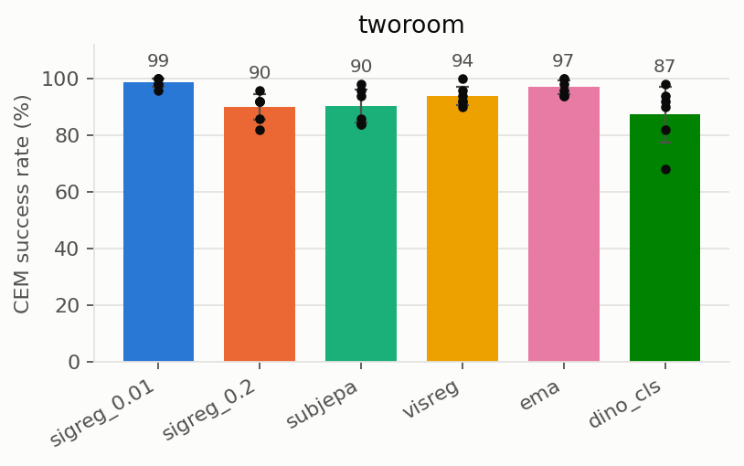
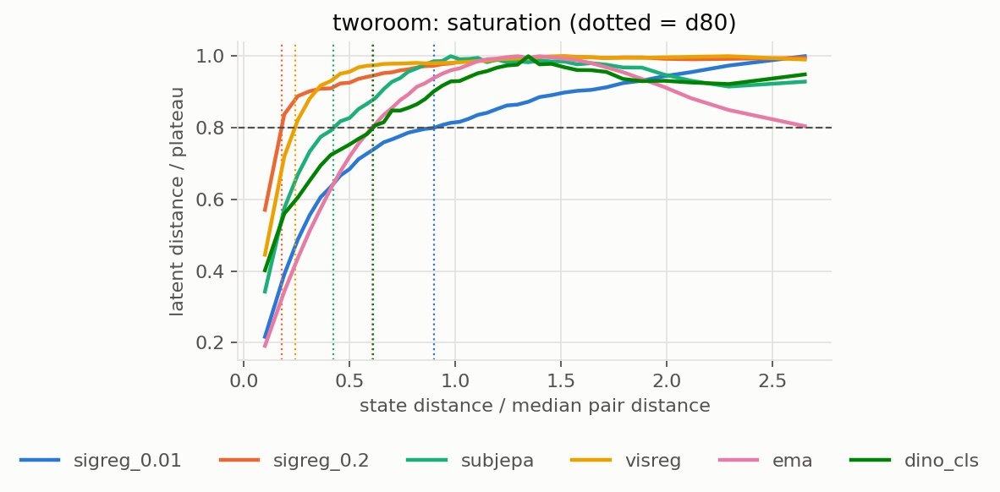
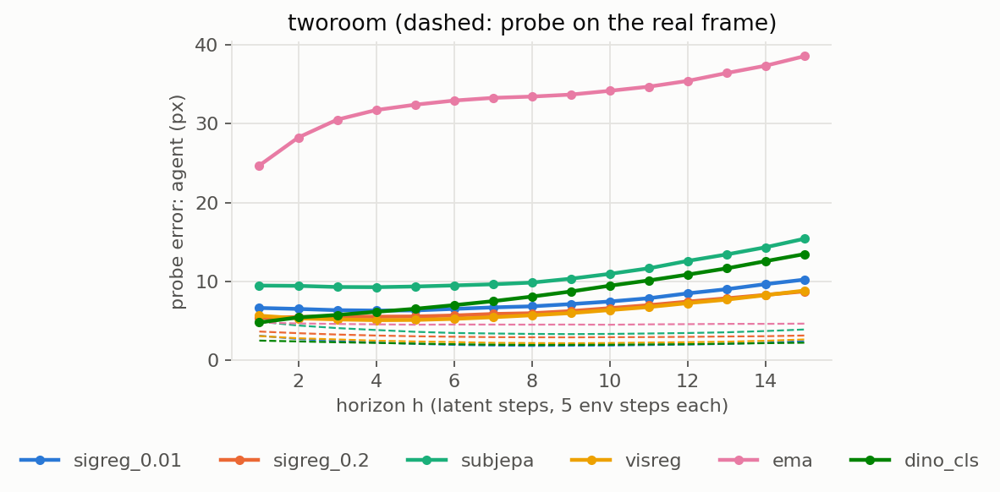
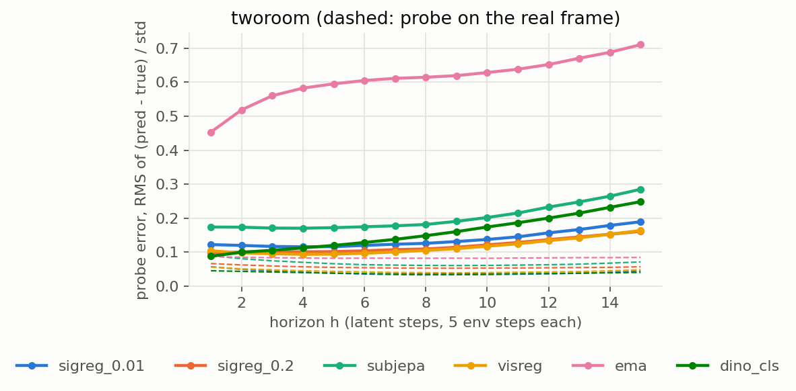
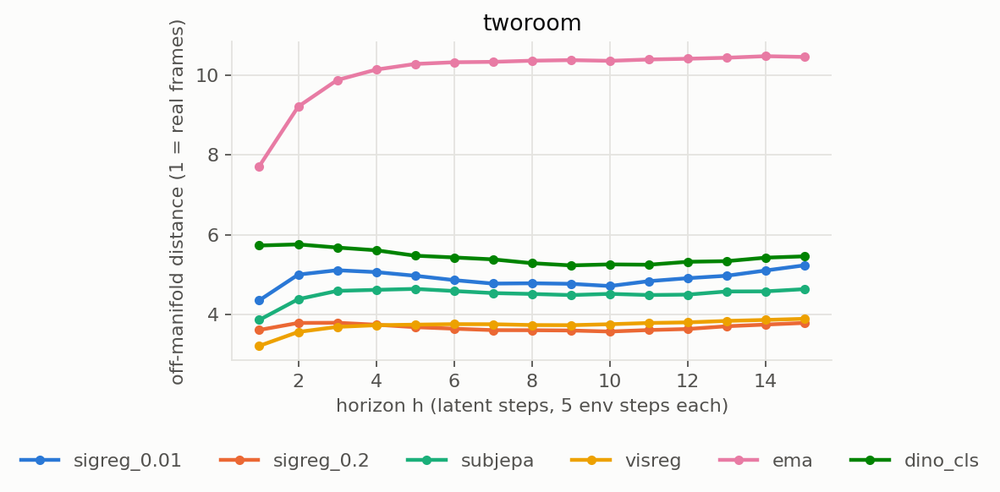
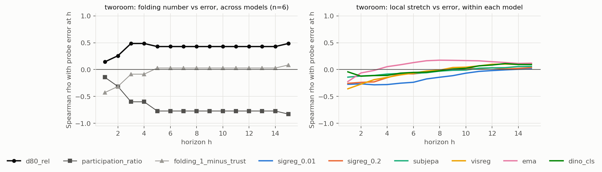

# Anti-collapse regularisers for latent world models: folding, drift and planning

> Status (2026-10-24): **TwoRoom complete; PushT training in progress.** Results below are TwoRoom only.

## 1. Question

A JEPA world model trained from pixels needs something that stops its encoder from collapsing. LeWM
uses SIGReg, which pushes the embedding towards an isotropic Gaussian. That prior may have a cost.
A low-dimensional state (an agent's x, y) can only fill a high-dimensional Gaussian if the latent curve
*folds*: it wiggles through many dimensions without crossing itself. Distances in latent space then
saturate quickly, and far-apart states look equally far.

We train the same world model with five ways of preventing collapse, plus a frozen-encoder baseline. For
each we ask:

1. How well does it plan (CEM success)?
2. How fast does its prediction error grow with the rollout horizon?
3. How folded is its latent space?
4. Does folding explain the error at each horizon, across models and within a model?
5. Do autoregressive predictions drift off the set of latents that real frames produce?

## 2. Setup

### 2.1 Models

All six share the LeWM architecture [1] and data. Only the anti-collapse mechanism differs.

| name | encoder | anti-collapse term | weight |
|---|---|---|---|
| `sigreg_0.01` | ViT-tiny, trained | SIGReg [1, 2] | λ = 0.01 |
| `sigreg_0.2` | ViT-tiny, trained | SIGReg | λ = 0.2 |
| `subjepa` | ViT-tiny, trained | SIGReg in K random subspaces (Sub-JEPA [3]) | λ = 0.09, K = 32 (TwoRoom) / 16 (PushT) |
| `visreg` | ViT-tiny, trained | scale + sliced-Wasserstein shape + centre (VISReg [4]) | λ = 0.6, convex form |
| `ema` | ViT-tiny, trained | none: EMA target network (BYOL / I-JEPA style [5, 6]) | momentum 0.996 → 1 |
| `dino_cls` | DINOv2-small CLS, **frozen** | none needed (DINO-WM [7, 8]) | — |

**Architecture.**
- Encoder: ViT-tiny/16 trained from scratch, 224 px input; its CLS token (192-d) goes through a BatchNorm MLP projector.
- Predictor: a 6-layer causal transformer (16 heads × 64, MLP 2048), conditioned on action blocks through AdaLN-zero.
- Size: 18.1 M parameters.
- `dino_cls`: replaces the encoder with frozen DINOv2-small (CLS token, 384-d, 196 px) and has no projector.

**Training.**
- Frameskip 5: one latent step is 5 environment steps, and its action is the flattened block of the 5 actions.
- History: 3 latent frames.
- Loss: teacher-forced next-latent MSE plus the regulariser.
- Optimiser for the five ViT models (the LeWM / Sub-JEPA recipe [1, 3]): AdamW, lr 5e-5, weight decay 1e-3, batch 128, grad clip 1, bf16; linear warm-up over the first 1% of steps, then cosine to 0.
- `dino_cls` uses DINO-WM's optimiser [7]: AdamW, lr 5e-4, weight decay 0.01, batch 32, constant lr, no clipping.
- Length: every model trains for **10 epochs of 2000 steps** (20k steps), one training seed each. Everything is evaluated on the final checkpoint, `epoch_009.pt`.

### 2.2 Regularisers

Let $Z \in \mathbb{R}^{N \times D}$ be the online embeddings of one timestep across the batch. Each regulariser is computed per timestep and averaged over the window's timesteps.

**SIGReg** [1, 2] tests random 1-D projections of $Z$ for normality with the Epps–Pulley statistic [9].
For unit directions $a_1, \dots, a_M$ ($M = 1024$, redrawn every step) and projections $u_{n} = z_n^\top a_m$:

$$
\hat\varphi_m(t) = \frac{1}{N} \sum_{n=1}^{N} e^{\,i t u_n}, \qquad
\mathrm{EP}_m = N \int_{0}^{3} \bigl|\hat\varphi_m(t) - e^{-t^2/2}\bigr|^2 \, e^{-t^2/2} \, dt,
\qquad
\mathcal{R}_{\text{SIG}} = \frac{1}{M} \sum_m \mathrm{EP}_m .
$$

The integral is a 17-knot trapezoid rule. The loss is $\mathcal{L} = \mathcal{L}_{\text{pred}} + \lambda\, \mathcal{R}_{\text{SIG}}$.

**Sub-JEPA** [3] applies SIGReg inside $K$ fixed subspaces. $P_k \in \mathbb{R}^{d' \times D}$ has orthonormal rows, $d' = D/K$, and is frozen at initialisation:

$$
\mathcal{R}_{\text{Sub}} = \frac{1}{K} \sum_{k=1}^{K} \mathcal{R}_{\text{SIG}}\!\left(Z P_k^\top\right).
$$

Each subspace draws its own projection directions. This is a port of the authors' `MultiSubspaceSIGReg`, in the `orthogonal_frozen` mode.

**VISReg** [4] keeps VICReg's variance term [10] and replaces the covariance term with a sliced-Wasserstein distance [11] to Gaussian quantiles.
With batch mean $\mu$, per-dimension std $\sigma_j$, the normalised embedding $\tilde Z = (Z - \mu)/\mathrm{sg}(\sigma)$ (sg = stop-gradient), and unit directions $w_k$ ($K = 2048$):

$$
\mathcal{L}_{\text{scale}} = \frac{1}{D}\sum_j (1 - \sigma_j)^2,\quad
\mathcal{L}_{\text{center}} = \frac{1}{D}\lVert \mu \rVert^2,\quad
\mathcal{L}_{\text{shape}} = \frac{1}{NK}\sum_{k}\sum_{i} \Bigl(\mathrm{sort}(\tilde Z w_k)_i - \Phi^{-1}\!\bigl(\tfrac{i}{N+1}\bigr)\Bigr)^2,
$$

$$
\mathcal{L} = (1-\lambda)\, \mathcal{L}_{\text{pred}} + \lambda\,(\mathcal{L}_{\text{scale}} + \mathcal{L}_{\text{shape}} + \mathcal{L}_{\text{center}}), \qquad \lambda = 0.6 .
$$

This is the paper's convex form and its small-dataset λ. No world-model value is published.
Note that the VISReg terms are on a different scale from SIGReg's: about 0.03 vs 1 on Gaussian input. So λ is not comparable across the two.

**EMA** [5, 6]: the prediction target comes from a gradient-free copy of the encoder and projector, $\bar\theta \leftarrow m\bar\theta + (1-m)\theta$, with $m$ rising linearly from 0.996 to 1 over training.

### 2.3 Data

| | TwoRoom | PushT |
|---|---|---|
| source | `quentinll/lewm-tworooms` (LeWM's recording) | `quentinll/lewm-pusht` |
| episodes | 10,000; 920,809 rows; 31–101 rows (mean 92) | 18,685; 49–246 rows |
| frames | 224 × 224 RGB | 224 × 224 RGB |
| state used for evaluation | agent $(x, y)$ in px | agent $(x, y)$, block $(x, y)$, block angle as $(\cos\theta, \sin\theta)$ |
| held out | 1,000 episodes (seeded split), never trained on | 1,000 episodes |

The evaluation state contains only what one frame shows, so velocities are excluded.

## 3. How each metric is computed

Code: `compare/analysis.py` (everything except CEM) and `compare/plan.py` (CEM). Every model is scored on the **same** frames, windows and CEM episodes: the seeds are fixed and the split is shared.

**Frame sets.**
- **Bank:** every 5th row of 3,000 random *training* episodes (57,240 frames on TwoRoom). It fits the probe, serves as the off-manifold reference and supplies neighbours for local stretch.
- **Held-out frames:** 10,000 random frames from the held-out episodes. Used for the folding metrics.
- **Windows:** 3 real context frames followed by a 15-step autoregressive rollout on the recorded actions. On TwoRoom, all 2,715 held-out start points that fit were used.

**State normalisation.** Every distance in state space uses $\tilde s = (s - \bar s)/\mathrm{std}(s)$, per dimension, with the bank's statistics.

### 3.1 CEM planning success

This follows LeWM's evaluation protocol [1], run with stable-worldmodel [12]: its `World`, `WorldModelPolicy` and `CEMSolver`, unchanged.
- **Episodes:** 50 start rows drawn with a seed from the recording. The goal is the recorded frame 25 env steps later, and the budget is 50 env steps.
- **CEM** [13]: 300 samples, 30 iterations, top 30, initial σ = 1. Each plan covers 5 action blocks (25 env steps); all 5 are executed before replanning, with warm start.
- **Cost:** with the current frame as context, roll the predictor forward over a candidate's action blocks and compare the last predicted latent with the goal frame's latent:

$$
c(a_{1:5}) = \bigl\lVert \hat z_{5}(o_t, a_{1:5}) - E(o_{\text{goal}}) \bigr\rVert_2^2 .
$$

- **Success:** the environment's own check. On TwoRoom, the agent within 16 px of the goal; on PushT, positions within 20 and block angle within π/9.
- **Seeds:** Sub-JEPA's six [3]: 42, 100, 2026, 3407, 1234, 4444.
- **Render check:** before evaluating, the environment renders a recorded state and the result is compared with the recorded frame. On TwoRoom the difference is 0.0/255, so the simulator matches the data exactly.

As in LeWM, start states are drawn from the whole recording, so about 90% come from training episodes. Only the start and goal *frames* can have been seen in training; the planner's trajectory between them is new.

### 3.2 Probe error vs horizon

A linear probe [14] reads the state off a latent. It is a closed-form ridge regression on standardised features, fitted on the bank:

$$
W = \bigl(X^\top X + \alpha N I\bigr)^{-1} X^\top Y, \qquad \alpha = 10^{-3}.
$$

For window $i$ the model sees real latents $z_{t-2:t}$, then predicts autoregressively:

$$
\hat z_{t+1} = f_\theta\bigl(z_{t-2:t}, a_{t-2:t}\bigr),\quad
\hat z_{t+h} = f_\theta\bigl(\hat z_{t+h-3:t+h-1}, a_{t+h-3:t+h-1}\bigr),
$$

where any $\hat z$ inside the context window is replaced by the real $z$ while still available. The unit-free error at horizon $h$ averages over windows the RMS error across the $K$ state targets, each scaled by its standard deviation $\sigma_k$:

$$
e(h) = \frac{1}{|W|}\sum_{i \in W} \sqrt{\frac{1}{K}\sum_{k=1}^{K}\left(\frac{\hat y_{ik}(h) - y_{ik}(h)}{\sigma_k}\right)^2},
\qquad \hat y = \mathrm{probe}(\hat z_{t+h}).
$$

- $e = 1$ means no better than predicting the mean state.
- We also report the error in physical units: agent position in px.
- The **floor** is the same probe applied to the *real* latent of frame $t+h$: the error that comes from the probe alone.

### 3.3 Folding

**Saturation distance $d_{80}$ (primary folding number).**
This is a scale-free version of a Shepard diagram [15], defined in this project. Take $P = 200{,}000$ random pairs of held-out frames, with $\Delta s = \lVert \tilde s_i - \tilde s_j\rVert$ and $\Delta z = \lVert z_i - z_j\rVert$.
1. Sort pairs into 40 quantile bins $b$ of $\Delta s$.
2. Normalise the mean latent distance per bin by its own maximum (the plateau):

$$
g(b) = \frac{\overline{\Delta z}_b}{\max_{b'} \overline{\Delta z}_{b'}} .
$$

3. $d_{80}$ is the state distance where $g$ first reaches 0.8, linearly interpolated, with the curve starting at $(0, 0)$.

We report $d_{80}^{\text{rel}} = d_{80} / \operatorname{median}(\Delta s)$. **Smaller means more folded:** latent distance stops growing early, so beyond a short state distance everything looks equally far.

On a synthetic pendulum angle, a smooth embedding $(\cos\theta, \sin\theta)$ gives $d_{80} \approx 106°$. Twenty harmonics give $d_{80} \approx 7°$, yet both have perfect trustworthiness. This is why trustworthiness is not the primary number.

**Effective dimension: the participation ratio** [16]. With $\lambda_j$ the eigenvalues of the latent covariance over the held-out frames:

$$
\mathrm{PR} = \frac{\bigl(\sum_j \lambda_j\bigr)^2}{\sum_j \lambda_j^2} \in [1, D].
$$

It is scale-free. A 2-D state embedded with a large PR has to fold.

**Trustworthiness and continuity** [17] (secondary). Over 5,000 held-out frames, let $r(i,j)$ be the rank of $j$ among the state-space neighbours of $i$, and $U_k(i)$ the latent $k$-nearest neighbours of $i$ that are *not* among its state $k$-nearest neighbours ($k = 10$):

$$
T(k) = 1 - \frac{2}{Nk(2N - 3k - 1)} \sum_{i=1}^{N} \sum_{j \in U_k(i)} \bigl(r(i,j) - k\bigr).
$$

Continuity $C(k)$ is the same with the two spaces swapped. We report $1 - T$ (self-intersection: different states mapped together) and $1 - C$ (tearing). Neither sees folding that never crosses itself.

### 3.4 Off-manifold distance vs horizon

This measures whether rollouts leave the set of latents that real frames produce. It is related to the $k$-NN manifold estimate used for generative-model precision [18]. With bank $\mathcal{B}$ and $d_{\text{NN}}(z) = \min_{b \in \mathcal{B}} \lVert z - b\rVert$:

$$
D_{\text{off}}(h) = \frac{\operatorname{median}_i\, d_{\text{NN}}\bigl(\hat z_{i}(h)\bigr)}{\operatorname{median}_{i,h}\, d_{\text{NN}}\bigl(z_{i}(h)\bigr)} .
$$

The denominator uses the *real* latents of the same held-out target frames, so $D_{\text{off}} \approx 1$ means the predictions look like encoded real frames. The bank holds training episodes only, so no query can be matched to a frame from its own episode.

### 3.5 Local stretch (within-model)

The Lipschitz argument for compounding error [19] says a map that stretches more amplifies errors more. For each window's last context frame (state $\tilde s_a$, latent $z_a$), take its $k = 32$ nearest bank states. Then fit the local Jacobian of state → latent by ridge regression on the offsets $\Delta S \in \mathbb{R}^{k \times d_s}$ and $\Delta Z \in \mathbb{R}^{k \times D}$:

$$
J_a = \bigl(\Delta S^\top \Delta S + \varepsilon I\bigr)^{-1} \Delta S^\top \Delta Z,
\qquad \varepsilon = 10^{-3}\, \tfrac{\operatorname{tr}(\Delta S^\top \Delta S)}{d_s},
\qquad \mathrm{stretch}_a = \frac{\lVert J_a \rVert_F}{\sqrt{d_s}}\Big/\operatorname{median}_a(\cdot).
$$

The final $\mathrm{stretch}_a$ is the RMS singular value of $J_a$, divided by the model's median. Within each model we report Spearman $\rho\bigl(\mathrm{stretch}_a, e_a(h)\bigr)$ at every horizon. The Lipschitz argument predicts $\rho > 0$, growing with $h$.

### 3.6 Correlations across models

For each folding number $F$ and each horizon, we compute Spearman's $\rho$ between the six per-model values of $F$ and the six mean errors $e(h)$; likewise against CEM success. The p-values are exact permutation tests over all $6! = 720$ orderings. With $n = 6$, $|\rho| \ge 0.89$ is needed for $p < 0.05$, so these are descriptive.

## 4. Results: TwoRoom

All numbers are for the final checkpoints; CEM uses 6 seeds × 50 episodes per model.

### 4.1 Planning



| model | CEM success % (mean ± std, 6 seeds) | per seed 42 / 100 / 2026 / 3407 / 1234 / 4444 |
|---|---|---|
| `sigreg_0.01` | **98.7 ± 1.5** | 100 / 96 / 100 / 98 / 100 / 98 |
| `ema` | 97.0 ± 2.5 | 96 / 94 / 94 / 98 / 100 / 100 |
| `visreg` | 94.0 ± 3.3 | 92 / 92 / 94 / 90 / 96 / 100 |
| `subjepa` | 90.3 ± 5.8 | 94 / 84 / 84 / 86 / 96 / 98 |
| `sigreg_0.2` | 90.0 ± 4.6 | 92 / 82 / 92 / 86 / 96 / 92 |
| `dino_cls` | 87.3 ± 9.9 | 98 / 68 / 90 / 94 / 82 / 92 |

- **Seed 100 is the hardest set of episodes** for almost every model. With it dropped for all models, the ranking barely changes: `sigreg_0.01` 99.2, `ema` 97.6, `visreg` 94.4, then a three-way tie of `sigreg_0.2` 91.6, `subjepa` 91.6 and `dino_cls` 91.2.
- **Free successes:** 4 of the 50 start states for seed 42 already lie within the 16 px success radius. This is the same for every model.
- **Against the papers:** Sub-JEPA [3] reports 84.3 ± 4.2 for LeWM (λ = 0.09) and 95.0 ± 2.8 for Sub-JEPA on TwoRoom, after training about 2.5× longer: 10 full passes over TwoRoom are ≈ 51k steps of batch 128, against our 20k.
- **Not explained yet:** our SIGReg models score above the paper's LeWM number. Running our evaluation on LeWM's released checkpoint would settle whether the gap is real or comes from our setup.

### 4.2 Folding



| model | $d_{80}^{\text{rel}}$ (smaller = more folded) | PR (effective dim) | latent dim | $1 - T$ | $1 - C$ |
|---|---|---|---|---|---|
| `sigreg_0.01` | 0.90 | 12.1 | 192 | 0.0003 | 0.0003 |
| `sigreg_0.2` | **0.18** | **50.9** | 192 | 0.0002 | 0.0002 |
| `subjepa` | 0.43 | 6.7 | 192 | 0.0006 | 0.0004 |
| `visreg` | 0.24 | 25.7 | 192 | 0.0003 | 0.0002 |
| `ema` | 0.61 | 6.1 | 192 | 0.0001 | 0.0001 |
| `dino_cls` | 0.61 | 3.8 | 384 | 0.0101 | 0.0054 |

- **Stronger SIGReg folds more.** Going from λ = 0.01 to λ = 0.2 shrinks $d_{80}^{\text{rel}}$ 5× (0.90 → 0.18) and raises the effective dimension 4× (12 → 51) for a 2-D state.
- **Trustworthiness is about 1 for every trained model.** The folding is real but never self-intersects, as predicted. Only frozen DINOv2 has measurable false neighbours.
- **`ema`'s curve rises, then falls** for the farthest state pairs. States far apart in the room end up closer in latent space than moderately distant ones: the latent bends back on itself.

### 4.3 Prediction error vs horizon





| model | $e(h)$ at h = 1 / 5 / 10 / 15 | agent error px, h = 1 → 15 (floor) |
|---|---|---|
| `sigreg_0.01` | 0.122 / 0.116 / 0.137 / 0.189 | 6.6 → 10.2 (3.1) |
| `sigreg_0.2` | 0.098 / 0.102 / 0.121 / **0.161** | 5.3 → **8.7** (3.6) |
| `subjepa` | 0.174 / 0.172 / 0.202 / 0.285 | 9.4 → 15.4 (4.9) |
| `visreg` | 0.104 / **0.094** / **0.117** / 0.164 | 5.6 → 8.8 (3.0) |
| `ema` | 0.453 / 0.595 / 0.629 / 0.711 | 24.7 → 38.6 (4.8) |
| `dino_cls` | **0.088** / 0.120 / 0.174 / 0.248 | **4.8** → 13.4 (2.4) |

$h$ is in latent steps of 5 env steps, so $h = 15$ is 75 env steps.

- **`dino_cls`** is the most accurate one step ahead but compounds fastest: its error triples by $h = 15$.
- **`ema`** carries little position information even one step ahead.

### 4.4 Off-manifold drift



| model | $D_{\text{off}}$ at h = 1 / 5 / 10 / 15 |
|---|---|
| `sigreg_0.01` | 4.35 / 4.97 / 4.71 / 5.23 |
| `sigreg_0.2` | 3.60 / **3.67** / **3.56** / **3.78** |
| `subjepa` | 3.86 / 4.64 / 4.51 / 4.63 |
| `visreg` | **3.20** / 3.74 / 3.75 / 3.88 |
| `ema` | 7.72 / 10.29 / 10.37 / 10.47 |
| `dino_cls` | 5.73 / 5.47 / 5.25 / 5.45 |

- **Every model predicts latents 3–5× farther from the real-frame set than real frames are**, already at $h = 1$. `ema` reaches 10×.
- **The drift stops growing:** after the first few steps, the distance stays roughly flat with the horizon.

### 4.5 Does folding explain error or planning?



Across the 6 models (Spearman $\rho$, exact permutation $p$):

| | $e(h{=}1)$ | $e(h{=}5)$ | $e(h{=}10)$ | $e(h{=}15)$ | CEM success |
|---|---|---|---|---|---|
| $d_{80}^{\text{rel}}$ | +0.14 (0.80) | +0.43 (0.42) | +0.43 (0.42) | +0.49 (0.36) | +0.37 (0.50) |
| PR | −0.14 (0.80) | −0.77 (0.10) | −0.77 (0.10) | **−0.83 (0.06)** | +0.14 (0.80) |
| $1 - T$ | −0.43 (0.42) | +0.03 (1.00) | +0.03 (1.00) | +0.09 (0.92) | −0.43 (0.42) |
| $e(h)$ itself | | | | | +0.71 (0.14) at h=1, +0.20 (0.71) at h=15 |
| $D_{\text{off}}(h)$ | | | | | +0.14 (0.80) at h=1, +0.26 (0.66) at h=15 |

Within each model, $\rho(\mathrm{stretch}, e(h))$ is −0.04 to −0.36 at $h = 1$ and 0.01 to 0.12 at $h = 15$, over 2,715 rollouts each (right panel).

### 4.6 Takeaways (TwoRoom)

1. **Folding did not raise prediction error; if anything it lowered it.**
   - More effective dimensions go with *lower* long-horizon error: ρ = −0.83, p = 0.06, the strongest relation in the data.
   - The most folded model (`sigreg_0.2`) has the lowest error at $h = 15$ and the least drift.
2. **Nothing we measured predicts planning success.** All six models reach 87–99%, which leaves too little spread on TwoRoom.
   - The clearest counter-example is `ema`: by far the worst probe error and drift, yet second-best at planning.
   - CEM uses latent distance to the goal, not a readable position, so the two can come apart.
3. **Local stretch does not drive compounding error.** Within each model, the correlation is weakly *negative* one step ahead and about zero by $h = 15$, not the positive, growing relation the Lipschitz argument [19] predicts.
4. **Trustworthiness is blind to this kind of folding:** about 1 for every trained model, while $d_{80}$ and PR vary 5–10×.

### 4.7 Limitations

- **Small n:** one training seed per model, and $n = 6$ for every across-model correlation.
- **Ceiling:** TwoRoom success is near 100% for all models.
- **Short training:** 20k steps per model, shorter than the papers'. A per-epoch analysis is planned only for PushT's `subjepa`, `visreg`, `ema` and `dino_cls`, the only runs with intermediate checkpoints saved.
- **λ not tuned:** VISReg's weight comes from its paper's small-dataset setting.
- **CEM start states** mostly come from training episodes (LeWM's protocol).
- **Probe dependence:** the probe is linear, so "probe error" includes how linearly the state is encoded, not only how accurate the prediction is.

## 5. Reproducing

```bash
cd lewm-cus
python compare/run.py                                   # setup, data, train, analyse, cem, report
python compare/run.py --tasks tworoom --stages cem report   # add CEM seeds / rebuild the report
python compare/run.py --tasks pusht --models subjepa visreg ema dino_cls \
       --stages analyse cem report --epoch 4            # an earlier checkpoint (from <run>/keep/)
```

Outputs:
- **Per model:** `checkpoints/compare/<task>/<model>/{analysis/analysis.json, analysis/windows.npz, cem/seed*.json}`.
- **Report:** `checkpoints/compare/report/` (`summary.md`, `summary.json`, figures).
- **Code:**
  - Regularisers: `src/models/regularizers.py`.
  - Metrics: `compare/analysis.py`.
  - Planning: `compare/plan.py`.
  - Tables and figures: `compare/report.py`.

## References

1. L. Maes, Q. Le Lidec, D. Scieur, Y. LeCun, R. Balestriero. *LeWorldModel: Stable End-to-End Joint-Embedding Predictive Architecture from Pixels.* arXiv:2603.19312, 2026.
2. R. Balestriero, Y. LeCun. *LeJEPA: Provable and Scalable Self-Supervised Learning Without the Heuristics.* arXiv:2511.08544, 2025. (SIGReg)
3. K. Zhao, D. Nie, Y. Lin, Z. Luo, Y. Gu, D.-P. Fan, D. Zeng. *Sub-JEPA: Subspace Gaussian Regularization for Stable End-to-End World Models.* arXiv:2605.09241, 2026.
4. *VISReg: Variance-Invariance-Sketching Regularization for JEPA Training.* arXiv:2606.02572, 2026.
5. J.-B. Grill et al. *Bootstrap Your Own Latent (BYOL).* NeurIPS 2020, arXiv:2006.07733.
6. M. Assran et al. *Self-Supervised Learning from Images with a Joint-Embedding Predictive Architecture (I-JEPA).* CVPR 2023, arXiv:2301.08243.
7. G. Zhou, H. Pan, Y. LeCun, L. Pinto. *DINO-WM: World Models on Pre-trained Visual Features enable Zero-shot Planning.* arXiv:2411.04983, 2024.
8. M. Oquab et al. *DINOv2: Learning Robust Visual Features without Supervision.* arXiv:2304.07193, 2023.
9. T. W. Epps, L. B. Pulley. *A test for normality based on the empirical characteristic function.* Biometrika 70(3), 1983.
10. A. Bardes, J. Ponce, Y. LeCun. *VICReg: Variance-Invariance-Covariance Regularization for Self-Supervised Learning.* ICLR 2022, arXiv:2105.04906.
11. N. Bonneel, J. Rabin, G. Peyré, H. Pfister. *Sliced and Radon Wasserstein Barycenters of Measures.* J. Math. Imaging Vis. 51, 2015.
12. *stable-worldmodel: A Platform for Reproducible World Modeling Research and Evaluation.* arXiv:2605.21800, 2026.
13. R. Rubinstein. *The Cross-Entropy Method for Combinatorial and Continuous Optimization.* Methodology and Computing in Applied Probability 1, 1999.
14. G. Alain, Y. Bengio. *Understanding intermediate layers using linear classifier probes.* arXiv:1610.01644, 2016.
15. R. N. Shepard. *The analysis of proximities: Multidimensional scaling with an unknown distance function. I.* Psychometrika 27, 1962.
16. P. Gao, E. Trautmann, B. Yu, G. Santhanam, S. Ryu, K. Shenoy, S. Ganguli. *A theory of multineuronal dimensionality, dynamics and measurement.* bioRxiv 214262, 2017.
17. J. Venna, S. Kaski. *Neighborhood preservation in nonlinear projection methods: An experimental study.* ICANN 2001.
18. T. Kynkäänniemi, T. Karras, S. Laine, J. Lehtinen, T. Aila. *Improved Precision and Recall Metric for Assessing Generative Models.* NeurIPS 2019.
19. K. Asadi, D. Misra, M. L. Littman. *Lipschitz Continuity in Model-based Reinforcement Learning.* ICML 2018.
